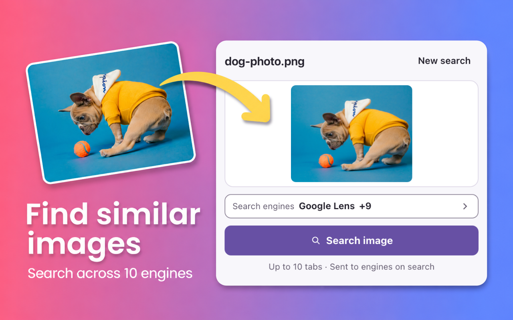
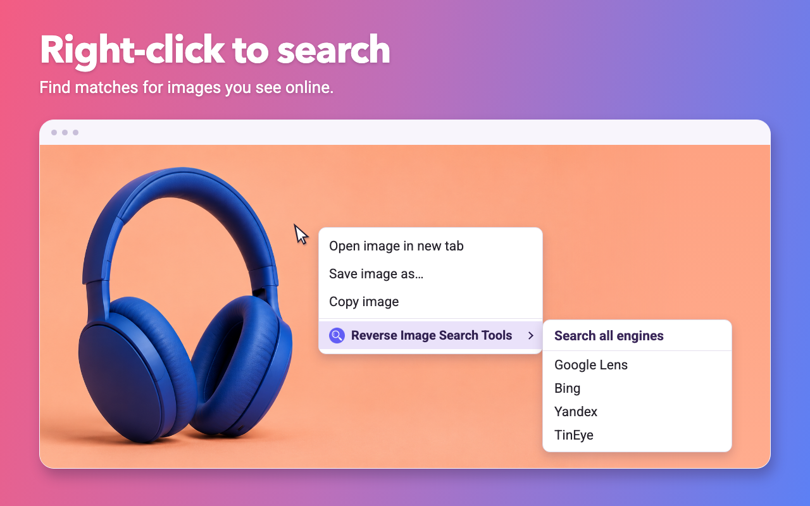
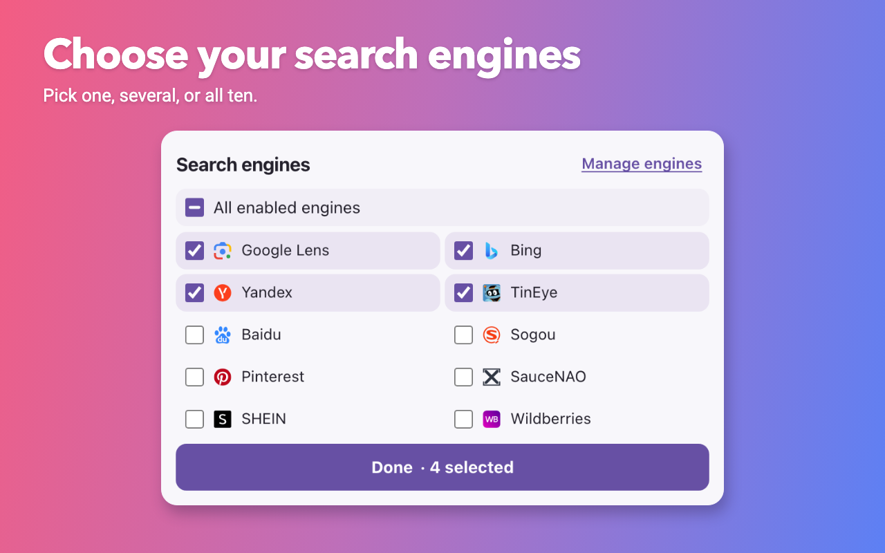

# Reverse Image Search Tools

Reverse Image Search Tools is a Chrome extension for reverse image search. Find where a photo appears online, look for similar images, or compare visual matches for a product.

**[Install from the Chrome Web Store](https://chromewebstore.google.com/detail/reverse-image-search-tool/hccicgceahocikgncfihpmkjamfpacpg)**

## How it works

### Upload an image

Open the Chrome side panel and click **Choose file** to upload a photo or screenshot. You can also drag in a file, paste an image from the clipboard, or enter a direct image link. Check the preview and click **Search image** when you’re ready.

*Preview the image before you send it to your chosen search engines.*

### Capture part of a page

To search by screenshot, choose **Capture area** in the side panel and draw a box around what you want to find. Click **Use capture** to bring the selected area into the search panel.

*Select just the part of the page you want to look up.*

### Right-click an image to search

Right-click a photo on a webpage and choose **Reverse Image Search Tools**. Pick one search engine or open results from all your enabled engines in separate tabs.

*Run a search directly from an image on the page.*

### Choose your search engines

Pick one engine for a quick lookup, or select several to compare results in separate tabs. Google Lens, Bing Visual Search, Yandex Images, and TinEye are selected by default on a fresh install.

Use **Add engines** in Settings to enable Baidu, Sogou, Pinterest, SauceNAO, SHEIN, and Wildberries.

*Choose which of your enabled engines to use for each search.*

See the [changelog](CHANGELOG.md) for version details.

## Build and test

Use the Node.js version in `.nvmrc` and run `npm ci` from the source directory.
Build with `npm run build:prod:chrome`. Load `dist/chrome` through
**Manage Extensions → Developer mode → Load unpacked**. Equivalent build
commands are available for Edge, Firefox, Opera, Safari, and Samsung Internet.
If the optional PNG optimizer cannot run, set `SKIP_PNG_OPTIMIZATION=true`.

Run logic tests with `node --test tests/*.test.js`. Install the Chromium
Playwright browser with `npx playwright install chromium`, then run
`npm run test:e2e` for the installed-extension tests. Provider responses in
these tests use local fixtures.

## License

See [LICENSE](LICENSE) and [NOTICE](NOTICE).
